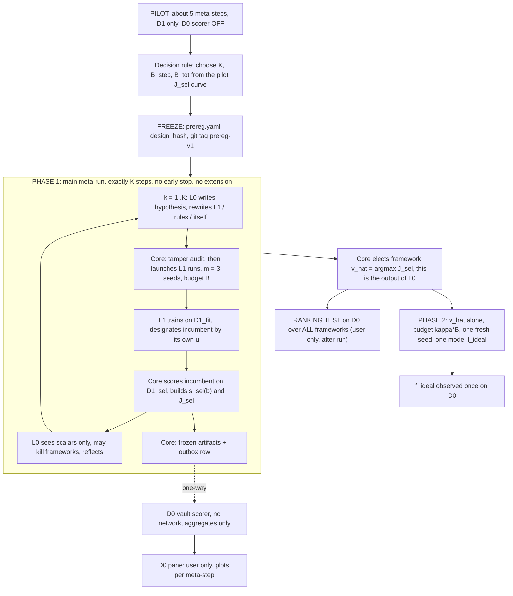

# Self-Referential Two-Level Research Agent: Experiment Specification (v6)

**Author:** Timothée Thibault. **Status:** implementation spec, 26 Oct 2026. It derives from `methodology.tex` v5 and `monitor_app_design.md` v3, plus the v6 decisions in Section 0.2.
**Audience:** a coding LLM that implements the experiment repo. Read Sections 0, 12 and 13 first. If this spec is ambiguous, stop and ask. Do not guess on anything touching D0, the core, or the freeze.

Labels used throughout: **[ASSUMPTION]** is an unmeasured estimate that the pilot must calibrate. **[UNVERIFIED]** is a number from a single quick run, not trusted. **[JUDGMENT]** is a design choice that is not derivable from data. **[OPEN]** is a parameter in Section 14 that the user may still change before the freeze.

---

## 0. How to read this document

### 0.1 One-paragraph summary
Level 0 (L0) is an LLM meta-agent that builds, runs and rewrites Level 1 (L1), an AIDE-style ML research agent, for ONE problem at a time (Problem 1: Jena Climate temperature forecasting; further problems one by one). **The output of L0 is a framework (an elected L1 framework), not a model.** An immutable core owns data custody, evaluation, budget and access control. Data is split chronologically into D1_fit (first 65% of N, given to L0 and L1), D1_sel (next 15%; labels held by the core) and D0 (last 20%, in a vault, scored automatically by a privileged scorer, visible **only to the user**, never fed back). A 48 h gap separates each pair, so the usable sets sit slightly under those fractions (Section 3.2). D1 means D1_fit + gap + D1_sel. The quality of an L1 run is the anytime area under its best-so-far normalised D1_sel score (`J_sel`), median over 3 seeds. The number of meta-steps `K` is fixed by a **pilot** (about 5 meta-steps) and frozen in the pre-registration, then is a hard min and max. After the runs, **all** L1 frameworks are scored on D0 and a **ranking test** checks whether the `J_sel` ordering predicts the D0 ordering. **Phase 2** runs the elected framework alone, once, at budget κB with one fresh seed, giving one model `f_ideal`, observed once on D0.

### 0.2 Decisions added on top of v5 (binding)
1. **K is no longer fixed at 10.** A pilot of about 5 meta-steps calibrates cost and measures how fast `J_sel` improves. K (likely 15–20) and `B_tot` are chosen from the pilot curve (D1 / `J_sel` only, never D0) and frozen before the main runs. After the freeze K is a hard min and hard max: no early stopping and no extension. A longer run is a new design version decided from D1 only (Sections 7, 9.4).
2. **The 5-fresh-seed re-evaluation of the elected framework is dropped.** It is replaced by the **ranking test** (Section 10.1) over all L1 frameworks, scored on D0.
3. **Phase 2 stays:** elected framework alone, budget κB, one fresh seed, one model `f_ideal`, observed once on D0 (observation only).
4. **D0:** automatic plots per meta-step for the user only. L0, L1, agents and automation never see D0 data, scores or plots. The vault design is that of `monitor_app_design.md` v3 (Section 9). The look-log and freeze/version-bump rules are kept.
5. **Output of L0 is a framework.** Aggregation over seeds is the **median**. Jena Climate is problem 1, then other problems one by one (Section 11.3).

### 0.3 Pipeline



---

## 1. Aims and research questions

- **Aim A (procedure quality):** how good is the procedure at finding the best architecture of the self-improving loop (the framework) for one problem?
- **Aim B (solution quality):** how good is the model `f_ideal` that the elected framework produces in Phase 2?
- **Aim C (selection quality, new in v6):** does the `J_sel` ordering of frameworks predict their ordering on unseen D0 data? Ordinality only, not absolute score (Section 10.1).

- **RQ1** At matched compute, how much does L0 improve `J_0` of the elected framework (Aim A) and `s_0`, MAE of `f_ideal` (Aim B) over a fixed L1 agent (arms 5, 6 vs 1) and over arms 2–4?
- **RQ2** Meta-overfitting: how do `g_k` and `J_0` evolve per step; does `J_0` peak before step K (`k† < K`)?
- **RQ3** Do mutable L1 rules improve cost-efficiency? **RQ4** Tree vs linear topology, and descendant-based parent score, at matched budget?
- **RQ5** Do RQ1–RQ4 replicate on further problems? **RQ6** (ranking test) Do `J_sel` rankings of all frameworks agree with D0 rankings; is the elected framework top on D0; what is the regret?

All expected results are hypotheses. A null result is informative but is a statement about this problem and budget only.

---

## 2. Nomenclature

Code identifiers are in backticks. "GPU-h" means GPU-hours as accounted by the core.

| Symbol | Meaning | Default / type |
|---|---|---|
| **A. Data, time, windows** | | |
| `t` ∈ {1..N} | hourly index; N hourly records | N = 70,128 |
| `z_t`, `y_t` | 14 raw variables at hour t; target `y_t` = air temperature T (°C) | °C |
| `c_t` ∈ R^4 | cyclical calendar features | Section 3.3 |
| `L`, `H` | look-back and horizon, hours | L = 24, H = 24 |
| `ω` | forecast origin: input rows ω−L+1..ω, targets y_{ω+1..ω+H} | integer hour |
| `D1` | D1_fit + gap + D1_sel; first 80% in time; given to L0 and L1 except D1_sel labels | hours 1..56,102 |
| `D0` | last 20% after embargo; vault; user-only; never fed back | hours 56,151..70,128 |
| `G` | embargo gap in hours (D1 to D0, and D1_fit to D1_sel) | G = L + H = 48 |
| `D1_fit`, `D1_sel` | 65% and 15% of N; fit = L1 trains and validates; sel = sealed selection set, labels held by the core | Section 3.2 |
| `Ω(S)` | origins with input and target inside S, stride 1 h | n_S − L − H + 1 origins |
| **B. Models, errors, scores** | | |
| `f` | model: `f(x_ω) = ŷ_ω` ∈ R^H | |
| `e(f;S)`, `ε(f;S)` | MAE (primary) and RMSE over Ω(S) and all H steps | °C |
| `e_base(S)` | min of persistence and seasonal-naive error on S | fixed, in core |
| `e_ref(S)` | best (min over model families) of the 5-seed mean error of the baseline pool on S | fixed, in core |
| `s(f;S)` | (e_base − e) / (e_base − e_ref) | 0 = base, 1 = reference |
| `s_sel`, `s_0` | `s(·;D1_sel)`, `s(·;D0)` | |
| `u_j` | L1's own validation score of candidate j (inside D1_fit) | L1 internal |
| **C. Budgets, iterations, seeds** | | |
| `B` | GPU budget of one L1 run (per seed) | 0.25 GPU-h [ASSUMPTION] |
| `K` | number of meta-steps; hard min and hard max; chosen by pilot, then frozen | 15–20 expected [OPEN] |
| `B_step` | budget of one meta-step (GPU-h plus tokens) | 3B = 0.75 GPU-h [ASSUMPTION] |
| `B_tot` | total budget of one meta-run = K · B_step (GPU-h and tokens) | Section 6 |
| `b` ∈ [0,B] | GPU-h consumed so far in an L1 run | |
| `f_j`, `b_j`, `n_max` | j-th candidate, GPU-h at its creation; cap on candidates | |
| `m` | L1 seeds per framework evaluation in the loop | 3 |
| `ξ`, `ξ_prod` | L1 seed; the single Phase-2 seed, not among the in-loop seeds | |
| `κ` | Phase-2 budget multiple (budget κB) | 10, range 5–10 [OPEN] |
| `r`, `n_meta` | independent meta-run (a full L0 run from scratch); count | n_meta = 3 |
| `K_pilot`, `n_pilot` | pilot meta-steps; pilot meta-runs | 5; 2 |
| **D. Agents, rules, core** | | |
| `A_θ` | L1 agent; θ = prompts, search policy, memory, operators, code | editable by L0 |
| `R` | L1 rules (n_max, wall-clock cap, in-run stopping rule, per-iteration budget split) | editable by L0 |
| `M_φ` | L0 agent; φ = its search loop, parent selection, prompts | editable by itself |
| `v = (θ,R,φ)` | a variant = one L1 framework | |
| `C` | immutable core | read-only |
| `k_top` | top variants eligible as parents (tree topology) | 5 |
| **E. Curves, objectives** | | |
| `f̃_{v,ξ}(b)` | incumbent at GPU-h b: candidate with highest `u_j` among `b_j ≤ b`; base predictor before the first | chosen on D1_fit only |
| `S_sel(b;v,ξ)` | `s_sel(f̃(b))`: best-so-far curve on D1_sel | per run |
| `S_0(b;v,ξ)` | same incumbents scored on D0 (observation only) | per run |
| `J_sel(v)` | median over seeds of (1/B)∫₀ᴮ S_sel db | drives L0 |
| `J_0(v)` | same with S_0; never used for any decision | observation only |
| `v̂` | output of L0: elected framework, argmax `J_sel` over all frameworks | D1 only |
| `f_ideal` | the one model of the Phase-2 run, designated by L1's own `u` | |
| `g_k`, `ḡ`, `k†` | overfitting gap at step k; shift reference gap (arm 1); hindsight argmax of `J_0` (descriptive) | |
| **F. Ranking test (Section 10.1)** | | |
| `F_r` | set of all frameworks evaluated in meta-run r (tamper-rejected ones excluded) | n_r = number of frameworks |
| `ρ_S`, `τ_b` | Spearman and Kendall (tau-b) rank correlations between `J_sel` and `J_0` over `F_r` | |
| `rank_0(v̂)`, `Reg` | D0 rank of the elected framework; regret = max_v `J_0(v)` − `J_0(v̂)` | |
| **G. Arms and problems** | | |
| `a` ∈ {1..6} | experimental arm (Section 8.1) | |

---

## 3. Problem 1 and data definitions

### 3.1 Task
Forecast the next H = 24 hourly temperatures from the past L = 24 hours of 14 measured variables plus calendar features (single-shot multi-step). Evaluation always uses the hourly grid and the interface of Section 5.4.

### 3.2 Exact default splits (Jena, N = 70,128)
Use **L = 24, H = 24, G = 48**. Fractions of N are **0.65 `D1_fit`, 0.15 `D1_sel`, 0.20 `D0`**. All indices are 1-based hourly indices after cleaning. Hour 1 = 01.01.2009 01:00; hour N = 01.01.2017 00:00.

Define `n_fit = ⌊0.65·N⌋ = 45,583` and `n_d1 = ⌊0.80·N⌋ = 56,102`. Each gap of G = 48 h is taken from the start of the later set.

| Set | Hours (index range) | n hours | Origins (n − 47) | Dates (default) | Who sees what |
|---|---|---|---|---|---|
| `D1` = `D1_fit` + gap + `D1_sel` | 1..56,102 (`n_d1`) | 56,102 | | 01.01.2009 01:00 to 27.05.2015 14:00 | L0 and L1, except D1_sel labels |
| `D1_fit` | 1..45,583 (`n_fit`) | 45,583 | 45,536 | to 15.03.2014 07:00 | L0, L1 (full) |
| internal gap | 45,584..45,631 | 48 | | 15.03.2014 08:00 to 17.03.2014 07:00 | nobody |
| `D1_sel` | 45,632..56,102 | 10,471 | 10,424 | 17.03.2014 08:00 to 27.05.2015 14:00 | labels in the core only; L0 sees scalars; L1 sees nothing derived |
| embargo (D1 to D0) | 56,103..56,150 | 48 | | 27.05.2015 15:00 to 29.05.2015 14:00 | nobody |
| `D0` | 56,151..70,128 | 13,978 | 13,931 | 29.05.2015 15:00 to 01.01.2017 00:00 | vault; user only |

Usable shares of N are 65.00% (`D1_fit`), 14.93% (`D1_sel`) and 19.93% (`D0`): the two gaps sit inside the 15% and 20% bands. `D0`'s hour range is the same 20% hold-out as before this cut. The D1_fit/D1_sel cut is the *recommended default*; under `split_authority = declare` L0 may propose another cut, validated by the core (3.4). `tests/test_splits.py` must reproduce every number in the table.

**Embargo logic:** G ≥ L + H so no input window overlaps a target of the other set. **Seasons in D1_sel:** MAM in 2014 and 2015, and JJA, SON, DJF once (10,471 h, above the 8,760 h floor). **Seasons in D0:** JJA and SON twice, DJF about twice, MAM once (≈3 months); season results are descriptive.

### 3.3 Data source, cleaning, features
- Source: Jena Climate CSV (Max Planck Institute for Biogeochemistry, 2009–2016), 420,551 rows × 15 columns, 10-minute resolution, 01.01.2009 00:10 to 01.01.2017 00:00 [as checked by the user on the downloaded file].
- Cleaning pipeline (`data/prepare.py`, deterministic, idempotent): sort by timestamp; drop 327 duplicated timestamps; reindex to a regular 10-minute grid (544 missing slots after de-duplication); set the sentinel −9999 to missing (wind speed 18 rows, max wind speed 20 rows); keep on-the-hour rows (do NOT take every sixth row, that drifts off the hour); fill gaps of up to 6 h by linear interpolation. Expected output: N = 70,128 hourly records. About 90 target values were missing before filling. `prepare.py` asserts N = 70,128 and fails otherwise.
- Features at origin ω: the L most recent hourly rows of the 14 variables plus `c_t = (sin(2π·hour/24), cos(2π·hour/24), sin(2π·doy/366), cos(2π·doy/366))`, i.e. an array of shape (L, 18). L1 may engineer features from D1_fit (including the raw 10-minute D1_fit data), but whatever the model needs at prediction time must be computable from the (L, 18) window.
- Raw data and splits are materialised by the core once: `data/splits/D1_fit.parquet` (L1 mount), `D1_sel_inputs/labels` (core only), `D0_inputs/labels` (vault only, split at ingestion). The raw 10-minute data of the D0 period is deleted from every run-side location.

### 3.4 Who defines D1_sel (declare-then-freeze)
`split_authority` ∈ {`fixed_default`, `declare`}. Arms 1–4 use `fixed_default`. Arms 5 and 6 use `declare` (the user's v5 choice), with ablation (iv) comparing it to `fixed_default`. Under `declare`, L0 submits once, before any L1 run, a JSON spec `{fit_end, gap, sel_ranges}`. The core validates it against the integrity rules, materialises it, keeps the D1_sel labels, and freezes it for the meta-run:
- D1_sel strictly after D1_fit with gap ≥ L + H = 48;
- D1_sel spans ≥ 8,760 h (every season represented);
- D1_fit ≥ 50% of D1;
- nothing outside D1 is referenced;
- the headroom check `e_ref ≤ 0.9 · e_base` on D1_sel holds.

Rolling-origin folds for D1_sel are allowed. A rejected spec falls back to `fixed_default` and is logged. After acceptance, the L0/L1 environments mount D1_fit only. **[JUDGMENT/tension]** In `declare` mode L0 sees the full D1 (labels included) during the one-time DeclareSplit stage, as in v5. This weakens the seal against L0 only (never L1, never D0). Section 16 lists it.

### 3.5 Baselines defining `e_base` and `e_ref`
| Predictor | Definition | Role |
|---|---|---|
| Persistence | ŷ_{ω,ℓ} = y_ω | base candidate |
| Seasonal-naive | ŷ_{ω,ℓ} = y_{ω+ℓ−24} | base candidate |
| Ridge | linear regression of the H outputs on the flattened, standardised window; penalty tuned on D1 only | reference pool |
| GRU, LSTM | recurrent encoder plus linear head, fixed recipe, 5 seeds | reference pool |
| Transformer encoder | small encoder over L steps plus linear head, fixed recipe, 5 seeds | reference pool |

```
e_base(S) = min{ e(persistence;S), e(seasonal-naive;S) }
e_ref(S)  = min over q in {ridge, GRU, LSTM, Transformer} of (1/5) * sum_{ξ=1..5} e(q_ξ; S)      for S in {D1_sel, D0}
```

The **same frozen baseline models**, trained on D1_fit only, are scored on both sets (D0 by the scorer in the vault). They are artifacts like any other. Recipes are tuned on D1 only, time-boxed, then stored in `core/baselines/`. Indicative values from one quick run on the superseded D1_sel (hours 44,930..56,102, the nested 80/20-of-D1 cut) [UNVERIFIED; ridge penalty picked on that set itself]: MAE persistence 3.41, seasonal-naive 2.53, ridge 1.87 °C (RMSE 4.60, 3.29, 2.49). They do not apply to the split in 3.2 and must be recomputed before use. GRU/LSTM/Transformer are not yet run, so the final `e_ref` is unknown. D0 has not been looked at.

---

## 4. Metrics and objectives (formulas)

All errors are over all origins in Ω(S) and all H steps.

- MAE: `e(f;S) = (1 / (|Ω(S)|·H)) Σ_{ω∈Ω(S)} Σ_{ℓ=1..H} |ŷ_{ω,ℓ} − y_{ω+ℓ}|`
- RMSE: `ε(f;S) = sqrt( (1 / (|Ω(S)|·H)) Σ_ω Σ_ℓ (ŷ_{ω,ℓ} − y_{ω+ℓ})² )`
- Normalised score: $s(f;S) = \dfrac{e_{base}(S) - e(f;S)}{e_{base}(S) - e_{ref}(S)}$. `s` can exceed 1 and is not a ceiling.
- Incumbent: $\tilde f_{v,\xi}(b) = f_{j^*(b)},\ j^*(b)=\arg\max_{j:\,b_j\le b} u_j$; base predictor (s = 0) before the first candidate. Ties on `u` go to the earlier candidate.
- Best-so-far curve: $S_{sel}(b;v,\xi) = s_{sel}(\tilde f_{v,\xi}(b))$. It is a step function, changing only when the incumbent changes. It need not be monotone (the incumbent is chosen on D1_fit).
- Per-run area (exact for a step function): with incumbent change points $0=b^{(0)}<b^{(1)}<\dots<b^{(q)}\le B$, scores $s_i$ on $[b^{(i)},b^{(i+1)})$ (and $b^{(q+1)}=B$), $A = \frac{1}{B}\sum_i s_i\,(b^{(i+1)}-b^{(i)})$.
- **Carry-forward convention [pre-registered, OPEN]:** if a run stops before B (n_max, wall-clock, stop rule, kill), the last incumbent score is carried to B. All areas are over the common reference budget B.
- Framework objective: $J_{sel}(v) = \operatorname{med}_{\xi}\, A_{sel}(v,\xi)$, median over the m = 3 seeds. With 3 seeds the median is the middle value. `J_0(v)` is the same with `S_0`. Always store the 3 per-seed values next to the median.
- Meta-objective of L0: $\max_{M,(v_k)} J_{sel}(\hat v)$ s.t. total spend ≤ B_tot, C unchanged, exactly K meta-steps. Election: $\hat v = \arg\max_{v\in F} J_{sel}(v)$ over all frameworks evaluated; ties broken by lower cost, then earlier step. Killed frameworks are eligible with carry-forward [OPEN].
- Overfitting curve (observation only): $v^*_k=\arg\max_{k'\le k} J_{sel}(v_{k'})$, $g_k = J_{sel}(v^*_k) - J_0(v^*_k)$; reference gap $\bar g = J_{sel}(v_1) - J_0(v_1)$ from all arm-1 runs; corrected gap $g_k - \bar g$ (rough: it assumes shift affects all variants alike). `k† = argmax_k J_0(v*_k)`, shown only as "hindsight, never fed back".
- Bootstrap: 95% CIs stratified over meta-runs × seeds, median aggregation (no IQM); a week-block bootstrap for D0 errors (one autocorrelated sample). With 3 seeds a CI cannot exceed the observed range, so no significance claim at framework level; report effect sizes with CIs.

**Winner's curse (brief).** `J_sel(v̂)` is the maximum over many noisy estimates on a set L0 has queried many times, so it is optimistic. This is why `J_sel(v̂)` is never reported as performance, and why `g_k` is shown. L1 never takes a max over candidates on D1_sel (`f̃` is chosen by `u`; the "max over candidates" curve is a labelled sensitivity analysis only). For the **ranking test the inflation does not matter**: D0 played no part in selection, and only ordinality is asked. Two selection effects still matter for it (Section 10.1): range restriction and lineage dependence.

---

## 5. System design: roles, interfaces, editable vs immutable

### 5.1 Roles
- **Core `C` (immutable, trusted):** separate read-only container and OS user `core`. Responsibilities, all in `core/`:
  1. *Data custody:* materialise splits; serve D1_fit to L1; hold D1_sel labels; never hold D0.
  2. *Evaluator:* score artifacts on D1_sel; compute `s_sel`, curves, `J_sel`. No agent-reported score is ever used.
  3. *Budget accounting:* GPU-h ledger (core job wrapper) and token ledger (core LLM gateway); enforce B, B_step, B_tot.
  4. *Orchestrator:* owns the step counter and the K horizon; invokes L0 once per step; launches L1 runs from L0's plan; exposes **no** stop/extend API.
  5. *Election:* argmax `J_sel`; L0 cannot override.
  6. *Tamper audit:* diff checks on every L0 edit (5.3).
  7. *Logging and control:* append-only event log, outbox writer, read-only artifact store, access control, checksums, `design_hash`.
- **L0 `M_φ` (editable by itself):** an LLM coding agent. Reads D1_fit and scalars from the core API, the archive, logs and the hypothesis log. Writes only `level0/` and `level1/`.
- **L1 `A_θ`:** AIDE-style tree search over complete training scripts (operators Draft, Debug, Improve). Trains on D1_fit with its own internal train/validation split and produces `u`. Hands the core a model artifact per candidate. Never receives D1_sel labels or any value derived from them.
- **D0 scorer (vault, user-started):** Section 9.

### 5.2 Editable vs immutable

| Editable by L0 | Immutable core `C` |
|---|---|
| L1 prompts, search policy, memory, operators, code θ | Sealed evaluator, metric code, frozen baseline models behind `e_base`, `e_ref` |
| L1 rules R: per-run budget split, n_max, wall clock, in-run stopping rule | Integrity checks on the split declaration; after acceptance, the D1_fit/D1_sel split and D1_sel labels |
| L0's own search loop, parent selection, prompts φ | Budget accounting (GPU-h, tokens), B, B_step, B_tot |
| Hypothesis log, archive annotations | Selection rule: only `J_sel` drives L0 choices; only L1's own `u` drives choices inside a run |
| Split of B_step between L1 frameworks (number, budget per seed, seeds); killing whole L1 frameworks | Logging of every edit and evaluation; network and file access control; D0 is absent (vault) |
| The one-time D1_fit/D1_sel declaration (if `declare`) | **K (hard min = hard max), B_step, B_tot, the J_sel computation, the carry-forward rule, the election rule** |

### 5.3 Core API (only these calls cross the L0/L1 to core boundary)

```python
# core/api.py  (client stubs in level0/ and level1/ talk to the core over a Unix socket)
class CoreL1API:                                   # inside an L1 sandbox
    def run_job(self, cmd: list[str], gpu: bool = True) -> JobResult   # times GPU occupancy, charges the ledger
    def llm(self, messages: list[dict], **kw) -> LLMReply               # core gateway: charges the token ledger
    def submit_candidate(self, model_dir: str, u: float) -> Ack         # Ack = {accepted: bool, model_id: str}; NOTHING else
    def remaining_budget(self) -> BudgetView                            # own run's gpu_h_left, tokens_left only
    # L1's incumbent = highest u among submitted. No score of any kind is returned.

class CoreL0API:                                   # inside the L0 sandbox
    def get_context(self) -> StepContext        # k, K, B, B_step, budgets left, archive, hypothesis log, J_sel scalars of past frameworks
    def declare_split(self, spec: dict) -> SplitAck                      # once, before step 1 (if split_authority == "declare")
    def progress(self, run_id: str) -> RunProgress                       # partial s_sel scalars and S_sel(b) points, no labels
    def kill(self, run_id: str, reason: str) -> None                     # logged; releases unspent share inside the same step
    def commit_plan(self, plan: "StepPlan") -> None
    # NOT AVAILABLE: stop(), extend(), set_K(), set_budget(), any D0 access.

@dataclass
class FrameworkSpec:
    framework_id: str; parent_id: str | None; level1_snapshot: str   # hash of the level1/ tree
    rules: dict; n_seeds: int; budget_per_seed: float; hypothesis: str   # hypothesis non-empty except v_1
@dataclass
class StepPlan: k: int; frameworks: list[FrameworkSpec]
```

L0 entry points: `level0.plan(ctx) -> StepPlan`, `level0.on_progress(ctx, progress) -> list[Kill]` (optional), `level0.reflect(ctx, results)`. The core rejects a plan that exceeds B_step, lacks a hypothesis, or touches the core.

**Tamper audit rules (core):** an L0 diff is rejected if it imports or reads core paths or `d0vault`; edits timers or budget counters; writes outside `level0/` and `level1/`; opens sockets other than the API socket; reads env vars outside an allow-list; or references any path under `/srv`. A random sample of accepted edits and all edits on the final best lineage are also audited by hand; the tamper rate per arm is reported. A rejected edit **still consumes its meta-step**.

### 5.4 Model artifact interface (fixed)
A candidate is a directory: `manifest.json` (`model_id`, `framework_id`, `seed`, `b_created`, `u`, `files_sha256`), `predict.py` exposing `predict(x: np.ndarray) -> np.ndarray` with `x` of shape (N, 24, 18) float32 and output (N, 24) float32, and weights/files only. No network, no absolute paths, no symlinks or hardlinks, regular files only, CPU inference. The core copies it into `/srv/artifacts/<sha256>/` (read-only, content-addressed). Scorers run `python -m runner /model /in/x.parquet /out/yhat.npy`.

### 5.5 Pseudocode of the loops

**L1 loop (inside the sandbox, per seed ξ):**
```python
def level1_run(api: CoreL1API, data_fit, R, seed):
    tree = Tree(root=draft_initial(api, data_fit, seed))
    while True:
        if api.remaining_budget().gpu_h_left <= 0 or tree.n >= R.n_max or R.stop(tree):  # in-run stopping only
            break
        node = tree.select()                          # by L1's own u, never by anything from D1_sel
        script = api.llm(...)                         # operator in {draft, debug, improve}
        job = api.run_job(["python", script])         # GPU time charged by the core
        if job.ok:
            api.submit_candidate(job.model_dir, job.u)  # u computed by L1 inside D1_fit; core scores silently
        tree.update(node, job)                        # L1 may kill its own branches on u and reports
    # no return value: the core already holds all candidates, b_j and u_j; the core hard-kills the run at B
```

**Evaluator (core), per candidate submission:**
```python
def on_submit(run, cand):                             # asynchronous; no result or latency visible to L1
    ledger.record_candidate(run, cand)
    inc = argmax_u(run.candidates_with(b_j <= cand.b))        # same rule as Section 4
    if inc != run.current_incumbent:
        s = score_sel(inc.artifact)                           # s(inc; D1_sel) with e_base, e_ref on D1_sel
        run.curve.append((cand.b, inc.id, s)); run.current_incumbent = inc
def run_value(run, B):    return area(run.curve, B)           # carry-forward after the run stops
def framework_value(fw):  return median([run_value(r, B) for r in fw.runs])     # J_sel
```
Scoring is inference on 10,424 origins per incumbent change: negligible, and not charged to B [ASSUMPTION].

**L0 loop (core-owned, exactly K steps; linear and tree topologies):**
```python
def meta_run(core, level0, K, topology):              # K read from the frozen prereg; core refuses K_min != K_max
    core.verify_checksums()                           # abort the run if the core hash changed
    if split_authority == "declare": core.accept_split(level0.declare_split(core.d1_view_for_declaration()))
    H = Archive()
    for k in range(1, K + 1):                         # exactly K iterations: no break, no extension
        core.verify_checksums()
        ctx = core.context(k, H)                      # fresh B_step; unspent budget never carried over
        if k == 1:
            plan = core.initial_plan()                # v_1
        else:
            parent = H.latest_accepted() if topology == "linear" else level0.select_parent(H.top(k_top))
            plan = level0.plan(ctx.with_parent(parent))      # hypothesis first, then rewrite of θ, R, φ
            if core.touches_core(plan) or not core.tamper_audit(plan):
                core.log_rejected(k, plan); continue          # the step is consumed
        results = core.run_step(plan, hooks=level0.on_progress)   # m seeds each, L1 sandboxes, kills, ledger
        H.add(k, plan, results)                       # J_sel scalars only for L0
        level0.reflect(ctx, results)
        core.emit_outbox(k)                           # frozen artifacts + meta_step_completed row; nothing comes back
    return core.elect(H)                              # v_hat = argmax J_sel over ALL evaluated frameworks: the output of L0
```
Linear: extend the latest accepted variant ("accepted" = `J_sel` improved). Tree: L0 picks a parent among the top-`k_top` by `J_sel` or by a clade score `CMP(v)` = mean `J_sel` over v and its descendants (a heuristic, not HGM's estimator). In both, φ is that of the current best variant. Cost depends on the number of L1 evaluations, not the topology, so the comparison is at matched budget.

**Kill rules.** L1 kills its own models, branches and heuristics using `u` and its own reports only. L0 kills whole frameworks using partial D1_sel scalars and reports; killing releases the unspent share inside the same step. Every kill is logged with its reason. Kills on D1_sel scalars count as selection steps for the winner's curse.

**Archive and hypothesis log.** Each variant stores parent, diff, `J_sel` (median and per seed), cost and hypothesis η ("I expect X to improve because Y; `J_sel` should rise by about Z"); after evaluation the core records confirmed or not.

---

## 6. Budget accounting and the fixed horizon

- **One total budget per meta-run:** `B_tot = K · B_step`, covering GPU-h **and** LLM tokens (L0's own tokens included): `G_tot = K·B_step_gpu`, `T_tot = K·B_step_tok`. Defaults before the pilot [ASSUMPTION]: B = 0.25 GPU-h, `B_step_gpu` = 3B = 0.75 GPU-h, `B_step_tok` ≈ 0.7M tokens. For K = 15: 11.25 GPU-h, ≈10.5M tokens; for K = 20: 15 GPU-h, ≈14M tokens. Final values come from the pilot (Section 7).
- GPU-h = GPU occupancy of jobs started through `core.run_job` (wall-clock × GPUs held); LLM latency is not GPU time; the sandbox has no GPU device otherwise.
- Per step, L0 decides how to split B_step (number of frameworks, budget and seeds each). With B_step = 3B one framework with 3 seeds fills a step, leaving L0 little room to split or reallocate; B_step = 6B is an [OPEN] option with real allocation. Unspent allocation is not carried over. A rejected step spends nothing and its budget is lost.
- Token ledger: every LLM call goes through the core gateway, recording `{role ∈ {L0, L1}, run_id, k, tokens_in, tokens_out}`. A step ends when its plan finishes or either cap is exhausted. The core cuts an L1 run at B (GPU) or its token share, and L0 at its token share.
- **Fixed horizon.** After the freeze `K_min = K_max = K` is a config invariant (the core refuses to start otherwise). There is no plateau, patience or early-stopping rule at L0; L0 cannot stop or ask for more steps; the run ends after step K. In-run stopping rules (inside one L1 run) stay editable. A crashed meta-run (infrastructure failure) is **restarted from scratch** with the same design and a new `run_id`, both logged; it is never resumed past K and never extended.
- **Phase 2 is outside `B_tot`** and cannot change the election. GPU spend of a meta-run is at most K·B_step.

---

## 7. Pilot and the freeze of K and B_tot

### 7.1 Purpose
Measure how fast `J_sel` improves with meta-steps and calibrate the cost per step, so K and `B_tot` can be fixed *before* the main runs from **D1 / `J_sel` only. D0 is never used** (the scorer is off, 7.2).

### 7.2 Pilot procedure
1. **Pre-conditions:** Phase 0–6 acceptance tests pass (Section 12), including the pen-test; the core is tagged `core-pilot`. D0 is already in the vault but the scorer service is **stopped** and the D0 pane disabled (embargo mode on). No D0 plot is produced in the pilot.
2. **Run:** `n_pilot = 2` pilot meta-runs of arm 6 (L0 tree, mutable rules, `split_authority = declare`), each `K_pilot = 5` meta-steps, provisional B = 0.25 GPU-h, `B_step = 3B`, m = 3 seeds, **pilot seeds disjoint from main seeds** (e.g. 9001..), same code path and core. Pilot runs are tagged `phase = pilot` and never enter any main analysis (including the ranking test).
3. **Measure and write `runs/pilot/pilot_report.json`** (D1 only):
   - cost: GPU-h per L1 run, training nodes per run, tokens per L1 run and per L0 step, wall-clock per step, scoring time;
   - `J_sel(v_k)` per framework and the pilot curve `C_r(k) = max_{k'≤k} J_sel(v_{k'})` (the framework L0 would elect after step k); `C(k) = median_r C_r(k)`;
   - seed noise `σ_seed` = median over frameworks of (max − min of the 3 per-seed areas);
   - headroom check (`e_ref ≤ 0.9 e_base` on D1_sel); whether `S_sel(b)` is still rising at b = B (informs κ);
   - tamper rate and fraction of rejected steps.
4. **Calibrate** B, B_step, `n_max` and the token share from measured cost: the smallest B at which a run holds a handful of training nodes (about 5–8 [ASSUMPTION]). If the final B_step differs from the pilot's by more than 25%, run one extra 3-step pilot meta-run with the new values before applying the rule.
5. **Main runs start from the initial v_1, not from pilot lineages.** Hand edits to initial `level0/`/`level1/` code from pilot findings (D1 only) are allowed before the freeze, committed with a message.

### 7.3 Decision rule for K [JUDGMENT: a pre-registered rule, not a law]
With `C(1..5)` from the pilot:
1. Recent gain rate `ĝ = (C(5) − C(2)) / 3` (mean of the last 3 pilot gains).
2. Noise floor `τ = max(τ_0, c · σ_seed)`, defaults `τ_0 = 0.01` (in `J_sel` units, i.e. 1% of the base-to-reference gap) and `c = 0.5`. Gains below this are indistinguishable from seed noise.
3. Assume geometrically decaying gains, `Ĝ(k) = ĝ · ρ_decay^(k−5)`, `ρ_decay = 0.85` default [JUDGMENT: 5 points cannot identify a decay rate; the default encodes "diminishing returns"].
4. `K_gain = 5` if `ĝ ≤ τ`, else `K_gain = 5 + ceil( ln(τ / ĝ) / ln(ρ_decay) )`: the smallest k at which the projected marginal gain drops below τ.
5. `K_budget = floor(B_cap / B_step)`, where `B_cap` is the per-meta-run cap on GPU-h and tokens set by the user [OPEN; default 15 GPU-h and ≈14M tokens].
6. `K = min( clip(K_gain, K_lo, K_hi), K_budget )`, defaults `K_lo = 15`, `K_hi = 20`. `K_lo = 15` because the ranking test needs enough frameworks (n ≥ 15) and the tree needs room to branch. If `K_budget < K_lo`, K = `K_budget` and the prereg records "budget-limited, below target window".

Worked examples (ρ_decay = 0.85, τ = 0.01): ĝ = 0.02 gives K_gain = 10, clipped to 15; ĝ = 0.06 gives 5 + ceil(11.02) = 17; ĝ = 0.10 gives 5 + ceil(14.2) = 20. The running max biases pilot gains upward (winner's curse), so the rule leans toward larger K; accepted. The user may override K **before** the freeze from D1 evidence only, recording the reason in `pilot_report.json`. Nothing about D0 may enter.

### 7.4 The freeze (after the pilot, before any main run)
1. Write `configs/prereg.yaml` (K, `K_min = K_max = K`, B, B_step, B_tot (GPU-h and tokens), m, κ, `ξ_prod`, seed lists, carry-forward and election rules, kill rules, τ, ρ_decay, bootstrap and ranking-test settings, arm definitions) and `PREREG.md`.
2. `python -m core.freeze`: refuses on a dirty tree; writes `core/CHECKSUMS.sha256`; computes `design_hash = sha256(core + configs + split hashes + initial level0/level1 + analysis code + d0vault code + runner image digest + PREREG.md)`; writes `prereg.json` (including the `pilot_report.json` hash); tags `prereg-v1`.
3. **Only then** is the D0 scorer started and the D0 pane enabled (embargo mode off if live viewing is wanted [OPEN]). Pilot results are never re-scored on D0.
4. After the freeze K and B_tot are hard constants. A longer run is a new design version (`core.freeze --bump`), decided from D1 only, applied to every arm; earlier runs are reported under their own version.

---

## 8. Experimental arms, ablations, endpoints

### 8.1 Arms
Every arm gets the same `B_tot` and the same K (no arm stops early or extends); every returned framework gets the same Phase 2 (κB, one fresh seed).

| # | Arm | Notes |
|---|---|---|
| 1 | Fixed AIDE-style L1 (v_1) | rerun with fresh seeds in each of the K steps (3 seeds per step); returned framework is v_1; its `J_0` is the median over all 3K runs; `fixed_default` split |
| 2 | Random search | over a hand-defined space of scaffold/rule configurations; one config × 3 seeds per step |
| 3 | Hyperband / BOHB | same space; own bracket schedule inside the same total GPU-h |
| 4 | ADAS-style | fixed meta-agent edits L1 prompts and code only (rules frozen, L0 not self-modifying) |
| 5 | L0 linear | Section 5.5; `declare` |
| 6 | L0 tree | Section 5.5; `declare` |

### 8.2 Ablations (2 meta-runs each, tree arm)
(i) mutable rules on/off; (ii) L0 self-modification (φ) on/off; (iii) parent score `J_sel` vs `CMP`; (iv) `declare` vs `fixed_default`.

### 8.3 Endpoints
- **Aim A primary:** `J_0(v̂_a^(r))` computed by the scorer from the 3 in-loop seeds (median), aggregated by the median over meta-runs r. Primary comparison: arm 6 vs arm 1. Secondary: arm 5 vs 1, arm 6 vs 5, L0 arms vs arms 2–4. These seeds also took part in the election, so `J_0(v̂)` keeps the seed part of the winner's curse (no fresh-seed correction). Report the per-seed spread.
- **Aim B:** MAE (and RMSE) in °C and `s_0` of `f_ideal` against `e_ref(D0)` and `e_base(D0)`; read against the spread of the three in-loop seed-incumbents of v̂ (typical vs lucky). A worse `f_ideal` than an in-loop incumbent is a finding, not a reason to swap models.
- **Aim C:** the ranking test (10.1) for every arm that produces many frameworks (arms 2–6). Arm 1 gives a **null calibration** (10.1, item 8).
- **Secondary:** `s_0` at B/4, B/2, B; by season (DJF, MAM, JJA, SON, with season-specific e_base, e_ref and hours); GPU-h and tokens per step; seed variance; tamper rate; `g_k`, `k†`.
- Statistics: median aggregation, stratified bootstrap 95% CI, probability of improvement. With 3 meta-runs per arm only large effects are detectable.

---

## 9. D0 vault and monitoring app (essentials of `monitor_app_design.md` v3)

### 9.1 Principles (binding)
1. **Core-written truth:** every number comes from an append-only event log written by the core; the app only reads it (kill via CLI `core kill`).
2. **One-way flow:** the run side only appends (artifact + event row). The scorer reads those and writes to a store the run side cannot read. No acknowledgement, status, error or timing returns to the run side.
3. **D0 is never in the run environment:** not mounted, not in the public DB (`eval_event.split` is `CHECK = 'sel'`), not in any mirror, not in git (only `data/D0.sha256`).
4. **No D1_sel leak into L1:** L1 sandboxes mount neither `runs/monitor.db` nor `runs/events/`; L0 sees D1_sel scalars only via the core API.
5. **OS-level barriers**, not conventions: separate Unix users, file modes, network namespaces, rootless container sandboxes, firewall.
6. **One viewer:** the D0 pane is for the user alone. Nothing computed from D0 is shown to, sent to, or readable by any other person, agent, automation or tool (collaborator and AI-assistant tooling included); no D0 value is pasted in any chat, document, ticket or prompt during the runs.
7. **Cheap and robust:** files, SQLite (WAL, local disk), Streamlit; a dead scorer or pane must not stop the experiment.

### 9.2 What the vault is
A protected folder owned by a separate OS user (`d0scorer`) holds D0, plus a scorer program the user starts personally. When a meta-step ends, the run side drops frozen artifacts and a row in an append-only outbox; the scorer runs each artifact in a no-network container on D0 *inputs only* and writes **aggregates only** to a database only the user can read (D0 pane, personal login). Nothing flows back. **Limit:** this stops accidental or opportunistic access by an unprivileged agent. Root, the scorer's OS user, or a container escape defeats it, so agents run rootless and the pen-test (AT6.1) must pass before the pilot.

### 9.3 Concrete setup
- **Storage:** `D0_inputs.parquet` and `D0_labels.parquet` in `/srv/d0vault/` (user `d0scorer`, dir `0700`, files `0600`), never mounted in an L0/L1 sandbox; best on a separate VM, minimum same host with separate users and rootless agent containers. Agents are users `exp1..expN`: no sudo, not in `d0view`/`d0scorer`, `hidepid=2`, `ptrace_scope=2`.
- **Scorer** (`d0-scorer.service`, `User=d0scorer`, started by the user): polls the outbox every 10 s. Row: `{event_id, type ∈ {meta_step_completed, production_run_completed}, k, run_id, model_id, artifact_path, artifact_sha256, design_hash, ts, hmac}`; file `chattr +a`, written only by user `core`. Per row: verify `design_hash`, HMAC (key known to core and scorer only), path under `/srv/artifacts/`, sha256; **skip if already scored (PK = artifact sha256, each artifact scored exactly once)**; run:
```
podman run --rm --network none --read-only --cap-drop ALL --security-opt no-new-privileges \
  --pids-limit 256 --memory 8g --cpus 4 --timeout 600 --tmpfs /tmp:size=2g \
  -v /srv/artifacts/<sha>:/model:ro -v /srv/d0vault/D0_inputs.parquet:/in/x.parquet:ro \
  d0-runner:<digest> python -m runner /model /in/x.parquet /out/yhat.npy
```
  Outside the sandbox the scorer validates `yhat` (N × 24, finite, float32), computes MAE, RMSE, `s_0` overall, by season and **by ISO week** (`n, Σ|err|, Σerr²`, for the block bootstrap), stores aggregates, deletes the array. Failures are a status in `d0_results` only. CPU-only. Scorer logs hold event ids and status codes, never metric values. The `d0-runner` image digest is part of the design hash.
- **What is scored:** every new incumbent artifact of every L1 run (all frameworks, all seeds) at the end of each meta-step, the baseline-pool artifacts, and the Phase-2 model. This covers **all** frameworks for the ranking test.
- **Results store:** `/srv/d0results/d0_results.sqlite` (dir `2770`, `d0scorer:d0view`, DB `0660`); `d0view` = `d0scorer` and `d0dash` only.
- **Two panes, two processes:** `dash-public` (user `dashpub`, :8501, `monitor.db` only) and `dash-d0` (user `d0dash`, `127.0.0.1:8502`, one account: the user's; scrypt hash in `/etc/d0dash/auth`, `0600`; TOTP recommended; one session at a time, short idle timeout; **no guest, share link, API token or export endpoint**). Host rule `nft add rule inet filter output meta skuid "exp*" tcp dport 8502 drop`. Agent sandboxes: own netns, allow-list egress (LLM gateway only), no route to host loopback.
- **Side channels** (timing, log leakage, shared GPU, artifact tricks, DB/screenshot reads, shell escapes, backups/mirrors) follow `monitor_app_design.md` Sec. 5: no ack path; fixed poll period; CPU-only scoring; symlinks/hardlinks rejected; D0-side files in `.gitignore` and excluded from rsync/MLflow/W&B; `auditctl -w /srv/d0vault -p rwa -k d0`; a canary token in the vault, scanned for in all agent logs, prompts and artifacts.

### 9.4 Freeze, version bump, look-log
- `core.freeze` as in 7.4; `core/verify.py` re-checks at each meta-step; the scorer checks `design_hash` on every row; a red banner shows if it changes.
- **All pre-registered decision rules reference D1 only** (kills, election, κ, K). No rule references a D0 value; `core`, `level0`, `level1` have no import path to D0 results (CI grep plus pen-test).
- **A design change after viewing D0 is a new design version:** `python -m core.freeze --bump "reason"` is the only way to change `configs/`. It reads `d0_audit.jsonl`; if any look happened since the last freeze it writes `changed_after_d0_view: true` and the last look's timestamp into `prereg.json` and the next report; later events carry the new hash; the banner reads "design vN, changed after D0 view at <ts>".
- **Look-log:** every D0 page load appends `{ts, session_id, page, params, design_hash, last_event_id_seen, prev_hash}` to `d0_audit.jsonl` (hash-chained, `chattr +a`) and `d0_view_log`; a top-bar counter shows "looks so far: n". Every row carries the same single user id; any other identity is an incident. The log is exported with the final report. Embargo mode (hides the pane until the run ends) exists for confirmatory reruns.
- **Final report** `d0vault/final_report.py` runs as `d0dash`, reads `d0_results.sqlite` and `monitor.db`, writes `reports/final/` (all steps and arms, ranking test, scatter plots, `g_k`, spread, season tables, `f_ideal`, look-log). No raw D0 leaves the vault; D0 numbers enter shared text only after the runs, by the user's own hand.

### 9.5 What the app shows
**Public pane (D1 only):** overview (state, design-hash OK, budget used vs plan, progress k / K, red banner on design change; no plateau or early-stop indicator); loop tree; performance (`s_sel(b)`, `J_sel` with CI, `u` vs `s_sel`); cost and GPU; logs; kills and allocation; Phase 2.
**D0 pane (user only, every load logged), automatic plots per meta-step:** (1) `S_0(b)` and `J_0` per framework (median, band = min–max of 3 seeds); (2) `g_k`, corrected gap, `J_sel` and `J_0` on one axis, `k†` marked "hindsight only"; (3) per-seed spread, for v̂ and `f_ideal`; (4) **ranking panel:** live scatter `J_sel` vs `J_0` of all frameworks so far, ρ_S, τ_b, rank of v̂, regret, four-point table, season tables; (5) audit log and scorer health (no values). Refresh `@st.fragment(run_every="10s")`.

---

## 10. Post-run analysis (user only)

### 10.1 The ranking test (replaces fresh-seed re-evaluation)
**Question.** Does the ordering of L1 frameworks by `J_sel` (D1_sel, used for selection) agree with their ordering by `J_0` (D0, no part in selection)? Only ordinality matters, not absolute score: winner's-curse inflation of `J_sel(v̂)` and any constant D1-to-D0 shift do not matter, only a monotone relation is tested.

**Population.** For each meta-run r, `F_r` = **all** L1 frameworks evaluated in meta-steps 1..K: v_1, every accepted, killed or non-elected framework, including the one ranked last by `J_sel`. Excluded: edits rejected by the tamper audit (never evaluated; counted and reported). No sub-sampling and no runners-up rule.

**Same treatment for all.** For each v ∈ F_r: `x_v = J_sel(v)` and `y_v = J_0(v)`, each the **median over the framework's 3 in-loop seeds** of the per-seed area (Section 4), from the same incumbents, same carry-forward convention, same reference budget B. Frameworks with fewer than 3 seeds (killed or split allocation) use the seeds they have and carry `n_seeds`; a sensitivity analysis restricts to `n_seeds = 3`.

**Statistics** (`analysis/ranking_test.py`, run once after the run ends; per-step live versions in the pane are plots only):
1. **Spearman ρ_S** (Pearson on average ranks) and **Kendall τ_b** (`(C − D) / sqrt((C + D + T_x)(C + D + T_y))`) between `x` and `y` over `F_r`.
2. **Uncertainty:** two-level bootstrap (resample frameworks, then each framework's 3 seeds before taking medians; 10,000 draws) for 95% CIs of ρ_S and τ_b; one-sided permutation p-value for `τ_b > 0` (10,000 permutations). Frameworks share lineage and are proposed adaptively, so effective n < n_r and the p-value is optimistic; report it with that caveat.
3. **Is the elected framework top on D0?** `rank_0(v̂) = 1 + #{v : y_v > y_v̂}`; indicator `rank_0(v̂) = 1`; top-3 membership; pairwise win probability `P_win = (1/(n−1)) Σ_{v≠v̂} [1(y_v̂ > y_v) + 0.5·1(y_v̂ = y_v)]`.
4. **Regret:** `Reg = max_v y_v − y_v̂` in J units and relative regret `Reg / (max_v y_v − min_v y_v)`: the D0 gap between the elected and the best-on-D0 framework. The best-on-D0 framework is descriptive and never selected or promoted.
5. **Four-point comparison by `J_sel` rank:** best (= v̂), 2nd best, median-ranked (rank ⌈(n+1)/2⌉), worst. Report `x`, `y`, `rank_0` for each, the differences `y_(1) − y_(n)`, `y_(1) − y_(med)`, `y_(1) − y_(2)` with bootstrap CIs, and whether the chain `y_(1) ≥ y_(2) ≥ y_(med) ≥ y_(n)` holds (descriptive).
6. **Scatter plot** of `y = J_0` vs `x = J_sel`, one point per framework, min–max seed bars on both axes, colour = meta-step k, markers for v̂, best-on-D0, worst-by-`J_sel`, median-ranked and second-best; annotate ρ_S, τ_b, `rank_0(v̂)`, n. Saved only under `reports/final/` (vault side).
7. **Aggregation across meta-runs:** per-arm median of each statistic over n_meta meta-runs, every per-run value listed. Frameworks are not pooled across meta-runs unless the split is `fixed_default` (then pooling is a labelled sensitivity). Optional extras: ρ_S by season; D0 week-block bootstrap of `y` for all frameworks jointly.
8. **Null calibration (arm 1):** the K per-step evaluations of the same v_1 (fresh seeds each) give pure-noise `(x, y)` pairs; its ρ_S/τ_b is the benchmark for "no real differences between frameworks".

**Known biases (state in the report).** *Range restriction:* later frameworks are proposed conditioned on high `J_sel`, concentrating the population and attenuating correlation. *Lineage dependence:* descendants share code. *Seed noise:* with 3 seeds `y` is noisy even without selection, capping the achievable correlation. *Small n:* n_r ≈ K, wide CIs. *No action:* nothing here is used to choose, replace, extend, stop or drop anything; if v̂ is not top on D0 that is a finding about selection quality.

### 10.2 Overfitting curve and `k†`
`g_k`, the corrected gap and `k†` (Section 4) are plotted at every step and finalised in the report (K points). `k† < K` means later steps overfit D1_sel. Descriptive only, never fed back (using it to set K of a later design would be a decision from D0).

### 10.3 Phase 2: production run
After Phase 1 returns v̂, the core runs v̂ **alone**: no L0, no framework kills, same core, split and logging. Budget `κB` (pre-registered, default 10, range 5–10; lean to 10 if the pilot shows `S_sel(b)` still rising at B). Exactly **one** run with **one fresh seed** `ξ_prod` (pre-registered, not among the in-loop seeds): one model. `f_ideal` is the incumbent that v̂ designates with its own `u` (never a max over D1_sel, never a choice on D0). The core emits `production_run_completed`; the scorer scores `f_ideal` on D0 **once**, observation only. "Ideal" means the best this framework produces at larger budget, not the best possible. The same κ applies to every arm. One run is one draw, read against the spread of the three in-loop seed-incumbents.

---

## 11. Data schema, repo layout, macro plan

### 11.1 Event log and tables
Every row has `id`, `ts` (UTC), `design_hash`. JSONL is the source of truth; SQLite (WAL) is the query layer; `monitor/ingest.py` rebuilds the DB from JSONL.

**Public `monitor.db` (D1 only)**

| Table | Key columns |
|---|---|
| `meta_step` | `k`, `t_start`, `t_end`, `budget_gpu_h`, `budget_tokens`, `hypothesis_id`, `hypothesis_text`, `status` (accepted/rejected), `phase` ∈ {pilot, loop}; k in 1..K from prereg; **no early-stop field** |
| `l1_run` | `run_id`, `k`, `framework_id`, `parent_framework_id`, `seed`, `alloc_gpu_h`, `alloc_tokens`, `status`, `kill_reason`, `phase` ∈ {pilot, loop, production}, `kappa`, `gpu_h_used`, `tokens_used` |
| `framework` | `framework_id`, `k_first`, `level1_snapshot`, `rules_json`, `n_seeds`, `j_sel_median`, `j_sel_seed1..3`, `ci_lo`, `ci_hi`, `n_killed`, `elected` (set by the core) |
| `model` | `model_id`, `run_id`, `branch_id`, `b_created`, `u`, `status`, `artifact_path`, `artifact_sha256`, `is_ideal_model` |
| `eval_event` | `run_id`, `model_id`, `b`, `split` **CHECK = 'sel'**, `s`, `e_mae`, `trigger`; views `curve_sel`, `j_run`, `j_sel(framework_id)` (median, carry-forward) |
| `ledger` | `role`, `run_id`, `k`, `gpu_h`, `tokens_in`, `tokens_out`, `cum_gpu_h`, `cum_tokens` |
| `gpu_sample`, `log_line`, `kill_event` | GPU samples; scrubbed logs; kills with reasons |
| `d0_outbox` | `event_id`, `type`, `k`, `run_id`, `model_id`, `artifact_path`, `artifact_sha256`, `hmac`; append-only (triggers refuse UPDATE/DELETE); **no D0 value** |

**Vault `d0_results.sqlite` (readable by `d0view` only)**

| Table | Key columns |
|---|---|
| `d0_score` | PK `artifact_sha256`, `model_id`, `run_id`, `framework_id`, `seed`, `k`, `b`, `e_mae`, `e_rmse`, `s0`, `n_origins`, `s0_djf/mam/jja/son`, `scorer_version`, `status` |
| `d0_score_week` | `artifact_sha256`, `week_idx`, `n`, `sum_abs_err`, `sum_sq_err` (aggregates only) |
| `d0_framework` | `framework_id`, `k`, `j0_median`, `j0_seed1..3`, `j0_min`, `j0_max`, `n_seeds` |
| `d0_gap` | `k`, `vstar_framework_id`, `j_sel`, `j0`, `g_k`, `g_k_corrected` |
| `d0_rank` | `k`, `n`, `spearman`, `kendall`, `elected_rank`, `p_win`, `regret`, `rel_regret`, `ci_json` (live per step; the row at k = K is the pre-registered test) |
| `d0_rank_point` | `k`, `framework_id`, `j_sel`, `j0`, `rank_sel`, `rank_0`, `n_seeds` (feeds the scatter) |
| `d0_view_log` | as in 9.4; one user id only |

`prereg.json`: `design_version`, `design_hash`, `K`, `K_min`, `K_max`, `B`, `B_step`, `B_tot`, `m`, `kappa`, `xi_prod`, `pilot_report_sha256`, `K_rule` (inputs and outputs), `changed_after_d0_view`, `last_d0_look_ts`, `git_tag`.

### 11.2 Repo layout
```
repo/                         # what agents may see (checkout), minus d0vault/ and runs/
  core/       # IMMUTABLE: CHECKSUMS.sha256 verify.py freeze.py api.py orchestrator.py evaluator.py ledger.py baselines/
  level0/  level1/            # editable by L0 (initial versions committed and hashed)
  data/  raw/  prepare.py  splits/  D0.sha256        # D1 only; D0 hash only
  configs/  design_v1.yaml  prereg.yaml  arms/*.yaml
  pilot/  run_pilot.py  decide_K.py  pilot_report.schema.json          # rule of Section 7.3
  monitor/  app_public.py  pages/  log.py  ingest.py  gpu_sampler.py  mirror_mlflow.py   # D1 only
  d0vault/  scorer.py  runner/(Dockerfile, runner.py)  app_d0.py  audit.py  sql/schema_d0.sql  final_report.py
            # CODE committed and hashed, deployed root-owned to /opt/d0; DATA never
  analysis/  ranking_test.py  overfit.py  aggregate.py  PREREG.md     # committed before the runs
  tests/  test_splits.py test_metrics.py test_sandbox_isolation.py test_core_checksum.py test_budget.py
          test_horizon.py test_fake_d0.py test_ranking_test.py test_decide_K.py
  runs/<exp>/<arm>/<meta_run>/  events/*.jsonl  monitor.db  artifacts/  logs/     # gitignored
/srv/d0vault/ (0700 d0scorer)   /srv/d0results/ (d0_results.sqlite, d0_audit.jsonl, reports/)
/srv/artifacts/<sha256>/ (core writes, read-only)   /srv/outbox/outbox.jsonl (core, +a)
```

### 11.3 Macro plan: further problems, one by one
After Jena, the same procedure for each problem p, **never jointly**: (M1) define data, target, metric, interface, baseline pool, headroom check; (M2) split D1/D0 (chronological with embargo for time series, random or stratified otherwise; D0 in the vault); (M3) **pilot, K/B_tot rule, freeze** (Section 7; K re-chosen per problem from that problem's D1 pilot); (M4) six arms and ablations at matched budget; (M5) automatic D0 scoring per step, ranking test, Phase 2 per returned framework, report everything with the look-log; (M6) record the discovered loop architecture and hypothesis log. Any design change between problems is a new design version with a written reason and a new freeze; earlier problems are not re-run. Problem-2 candidates (none decided): ETTh1/ETTm1, Electricity load, California Housing (i.i.d. split), CIFAR-10 (much higher cost). Cross-problem aggregates are descriptive until P ≥ 3.

---

## 12. Implementation checklist with acceptance tests (AT)

Do not start a phase until the previous phase's tests pass. All ATs are automated in `tests/` or CI unless marked manual.

**Phase 0, scaffolding and a fake world**
- [ ] Repo layout, `configs/`, CI, `.gitignore` (runs/, D0 results, reports/). Fake data generator (synthetic hourly series plus a **fake D0** with a known shift); fake L1 and fake frameworks with known behaviour.
- AT0.1 fake end-to-end run (3 steps) writes JSONL and rebuilds `monitor.db`; `grep` finds no D0 value in `monitor.db`, JSONL or logs.

**Phase 1, data and metrics**
- [ ] `data/prepare.py`, split materialiser, `core/metrics.py`, baselines in `core/baselines/`.
- AT1.1 `test_splits` reproduces every number of 3.2 (45,583 / 45,631 / 45,632..56,102 / 56,151..70,128; origins 45,536, 10,424, 13,931); no window of one set overlaps another set.
- AT1.2 `test_metrics`: MAE/RMSE match an independent numpy reference; `s = 0` for the base predictor and `s = 1` for the reference on the same set.
- AT1.3 cleaning asserts N = 70,128 and no −9999 remains.

**Phase 2, core (evaluator, budget, orchestrator)**
- [ ] Artifact store, evaluator, step-function area, ledger, job wrapper, LLM gateway, orchestrator, election, tamper audit.
- AT2.1 `test_sandbox_isolation` (as `exp1`, inside the L1 container): cannot list, open or stat D1_sel labels, `/srv/*`, D0 (including a content search for a planted canary), `runs/monitor.db`, `runs/events`; `submit_candidate` returns only `{accepted, model_id}`; no network except the gateway; the same for the L0 container after the split is accepted (D1_fit only).
- AT2.2 `test_core_checksum`: flip one byte in `core/` ⇒ `verify.py` exits non-zero, the orchestrator refuses the next step, the scorer refuses rows with the old `design_hash`.
- AT2.3 `test_budget`: a fake L1 burning known GPU-seconds (fake clock) and known tokens ⇒ ledger matches within 2%; an L1 run is hard-killed at B; Σ(step spend) ≤ K·B_step; an L0 plan above B_step is rejected; unspent budget is not carried over; a rejected step consumes the step but not budget.
- AT2.4 `test_horizon`: L0 tries early return, `stop()`, `extend()`, `set_K()` ⇒ unavailable or no-ops; exactly K steps run even if L0 raises on some; config with `K_min != K_max` is refused.
- AT2.5 area test: a hand-built step curve gives the exact analytic `A`; carry-forward after a kill and the 3-seed median (with ties) match hand calculations.
- AT2.6 tamper audit rejects each forbidden pattern of 5.3 (fixtures) and accepts benign edits.

**Phase 3, L1 and baselines**
- [ ] AIDE-style L1 via `CoreL1API`; baseline pool run once on D1_fit; `e_base`, `e_ref` on D1_sel.
- AT3.1 L1 runs end to end on the fake world within B and calls nothing outside `CoreL1API`. AT3.2 headroom check on real D1_sel: `e_ref ≤ 0.9 e_base`.

**Phase 4, L0, arms, hypothesis log**
- [ ] L0 linear and tree; split declaration and validation; kill hooks; arms 1–4 harnesses; arm configs.
- AT4.1 integrity rules reject gap < 48, D1_sel < 8,760 h, D1_fit < 50%, reference outside D1; fallback to default is logged. AT4.2 a framework without hypothesis (except v_1) is refused.

**Phase 5, monitor and vault on the fake D0**
- [ ] Public pane; scorer with the real interface (different OS user if possible); D0 pane with password and audit log.
- AT5.1 `test_fake_d0` (**known predictors**): on the fake D0, persistence, seasonal-naive, ridge and an oracle-with-noise artifact give scorer MAE equal to an independent computation (tol 1e-6); `s_0 = 0` for the base and `1` for the reference; scoring is idempotent; a scorer crash does not stop a fake run (outbox grows).
- AT5.2 `test_ranking_test` with known truth: `J_0` a monotone increasing function of `J_sel` ⇒ ρ_S = τ_b = 1, `rank_0(v̂) = 1`, regret 0; reversed ⇒ −1; independent random ⇒ small |ρ_S| and a CI containing 0; ties handled; n = 3 and n = 20 work; four-point table correct.
- AT5.3 D0 pane reachable only on 127.0.0.1:8502 with the single account; a second concurrent login is refused and logged; each page load appends a hash-chained audit row; the public pane works with the scorer stopped.
- AT5.4 CI grep: no import path from `core`, `level0`, `level1`, `monitor` to D0 results.

**Phase 6, real vault and pen-test (manual + scripted, before any pilot)**
- [ ] Users, groups, `/srv` modes, rootless podman `d0-runner` (pinned digest), nft rule, agent netns, `hidepid=2`, auditd, canary, HMAC, `chattr +a`. **The user loads the real D0; the coding LLM never reads, prints or inspects it.**
- AT6.1 as `exp1`: `ls /srv/d0vault`, open `d0_results.sqlite`, connect to :8502, read the HMAC key, ptrace the scorer, create a second D0 account, reach an export endpoint ⇒ **all must fail**. Dry run of 2 fake meta-steps on the real vault; canary scan finds no token in any agent log.

**Phase 7, pilot (Section 7)**
- [ ] Run with the scorer stopped; write `pilot_report.json`; run `pilot/decide_K.py`.
- AT7.1 `test_decide_K` reproduces the worked examples of 7.3 (ĝ 0.02 ⇒ 15, 0.06 ⇒ 17, 0.10 ⇒ 20; flat ⇒ K_lo; `K_budget` < K_lo ⇒ budget-limited K plus flag); `decide_K.py` has no code path that opens D0 results. AT7.2 pilot runs are tagged `phase = pilot` and excluded from every main analysis.

**Phase 8, freeze**
- [ ] `prereg.yaml`, `PREREG.md`, `core.freeze`, tag `prereg-v1`; then enable the scorer.
- AT8.1 `core.freeze` refuses on a dirty tree; `design_hash` changes when any hashed file changes; a bump after a fake D0 look writes `changed_after_d0_view: true`; tampering shows the red banner.

**Phase 9, main runs**
- [ ] 6 arms × 3 meta-runs (+ ablations) at matched `B_tot`, K steps each; alerts (budget 80%, scorer queue stuck, vault access attempt, second D0 login attempt).
- AT9.1 each meta-run has exactly K `meta_step` rows (accepted or rejected); spend ≤ `B_tot`; no row carries a different `design_hash`.

**Phase 10, analysis, Phase 2, report**
- [ ] `analysis/ranking_test.py` (fake world first, then real); Phase-2 runs; `final_report.py`.
- AT10.1 the final report contains all arms and steps, the look-log, the ranking test (ρ_S, τ_b with CIs, `rank_0(v̂)`, regret, four-point table, scatter) and `f_ideal`; no raw D0 outside the vault.

---

## 13. DO NOT rules (for the coding LLM; any violation invalidates the experiment)

1. **Never read, open, print, `cat`, `head`, `ls`, summarise, hash-compare or log anything from D0** (data, labels, predictions, scores, plots, aggregates, `d0_results.sqlite`, `d0_audit.jsonl`, `reports/final/`). Only the user touches the real vault. Develop and test on the **fake D0**.
2. **Never put D0 (or anything derived) in a prompt, log line, test fixture, commit, issue, chat or screenshot.** If you suspect a vault bug, say so **without quoting values**.
3. **Never change the core after the freeze** (`core/`, `configs/`, scorer code, runner image, `PREREG.md`) except via `core.freeze --bump` run by the user. Never edit `CHECKSUMS.sha256` by hand.
4. **Never give any agent, tool or CI** the D0 password, HMAC key, `d0view` membership, root, a container-runtime socket or a mount of `/srv`.
5. **Never let a D0 value reach L0, L1 or any decision rule** (kill, election, K, κ, arm choice). The K rule uses the pilot D1 curve only.
6. **Never implement early stopping, plateau/patience rules, K extension or a `stop()`/`extend()` API at L0.** K is a hard min and max.
7. **Never return a D1_sel value, score, residual, latency or error text to L1.** `submit_candidate` returns only `{accepted, model_id}`.
8. **Never take a max over candidates on D1_sel**, inside a run or to designate `f_ideal`. The incumbent is chosen by L1's own `u`.
9. **Never use a score self-reported by an agent;** the core recomputes everything from artifacts.
10. **Never choose the best-on-D0 framework or the best of three seeds,** and never re-run to "look better". Seeds are replicates, not candidates.
11. **Never include the pilot in main analyses** or reuse pilot seeds.
12. **Never mirror D0-side data** to MLflow, W&B, git, rsync or backups. **Never add an export endpoint, second account or share link** to the D0 pane.
13. **Never add an acknowledgement, status or error channel** from the scorer to the run side, and never swallow a vault-path failure silently.
14. **Never resume a crashed meta-run past K or extend it;** restart from scratch with a new `run_id`.
15. Do not invent numbers: a value absent from this spec is an [OPEN] parameter or a question to the user.

---

## 14. Open parameters and defaults

| Parameter | Default | Status |
|---|---|---|
| `L`, `H`, `G` | 24, 24, 48 | adjustable before freeze |
| fractions of N: `D1_fit`, `D1_sel`, `D0` | 0.65; 0.15; 0.20 | fixed |
| `split_authority` (arms 5/6; arms 1–4) | declare; fixed_default | [OPEN] |
| D1_sel integrity rules | ≥ 8,760 h; gap ≥ 48; fit ≥ 50% of D1; headroom 0.9 | fixed |
| `B` | 0.25 GPU-h | [ASSUMPTION], pilot |
| `B_step` | 3B = 0.75 GPU-h (+ ≈0.7M tokens) | [ASSUMPTION], 6B option [OPEN] |
| `m`, `n_meta` | 3, 3 (m = 5 option) | [OPEN] |
| `K_pilot`, `n_pilot` | 5, 2 | [OPEN] |
| `K_lo`, `K_hi` | 15, 20 | [OPEN] |
| `τ_0`, `c`, `ρ_decay` | 0.01, 0.5, 0.85 | [JUDGMENT] |
| `B_cap` per meta-run | 15 GPU-h, ≈14M tokens | [OPEN] |
| `K`, `B_tot` | from pilot | frozen in prereg |
| `κ` | 10 (range 5–10) | [OPEN] |
| `ξ_prod`, pilot seeds, main seeds | disjoint lists in prereg | fixed at freeze |
| carry-forward; killed frameworks eligible | carry last score to B; yes | [OPEN] |
| `k_top` | 5 | [OPEN] |
| ranking test: bootstrap draws; permutations; block | 10,000; 10,000; 1 week | [OPEN] |
| scorer poll, timeout, memory/CPU | 10 s, 600 s, 8 GB / 4 CPUs | [OPEN] |
| `n_max`, wall-clock cap, in-run stopping | L0-editable; initial from pilot | pilot |
| embargo mode (main arms) | off (live D0 viewing wanted) | [OPEN] |
| vault hosting | separate VM if available, else same host with separate users | [OPEN] |

---

## 15. Compute and time estimates

**All numbers are [ASSUMPTION] until the pilot calibrates them.** Basis: Jena is small (45,536 training origins on D1_fit), so a GRU-sized script takes about 1–3 min on one GPU, giving about 5–8 nodes per B = 0.25 GPU-h run. Loop cost per meta-run = K · 3 seeds · B (a cap, no early stopping; L0 overhead is counted in tokens, not GPU-h). v5 at K = 10 totalled ≈316 GPU-h.

| Item | Count | GPU-h each | K = 15 | K = 20 |
|---|---|---|---|---|
| Pilot (2 meta-runs of 5 steps + calibration, sanity checks) | | | ≈ 30 | ≈ 30 |
| Main arms 1–6: 6 × 3 meta-runs | 18 | K·0.75 (11.25 / 15) | 202.5 | 270 |
| Ablations (i)–(iv): 4 × 2 meta-runs | 8 | K·0.75 | 90 | 120 |
| Baseline pool (4 models × 5 seeds, once per distinct split, ≤ 26) | 26 | ≈ 1 | ≈ 26 | ≈ 26 |
| Phase 2: (18 + 8) runs × κB (κ = 10) | 26 | 2.5 | ≈ 65 | ≈ 65 |
| **Total** | | | **≈ 414** | **≈ 511** |

- On 8 GPUs, perfectly parallel: ≈ 52 h (K = 15) or ≈ 64 h (K = 20). D0 and D1_sel scoring are inference only, negligible.
- **Wall clock per meta-run** at 25–40 min per step (L1 run ≈ 15 min at B plus L0 LLM time): ≈ 6–10 h (K = 15), ≈ 8–13 h (K = 20). Sequential time, not GPU, is the binding constraint; the 26 meta-runs parallelise.
- **Tokens:** 0.4–0.7M per meta-step (guesses) ⇒ ≈ 6–10.5M per meta-run at K = 15, ≈ 8–14M at K = 20; ≈ 156–273M (K = 15) or ≈ 208–364M (K = 20) over 26 meta-runs, plus the pilot. Tokens remain the dominant monetary cost.
- If compute is short, use 2 meta-runs per baseline arm; never reduce K after the freeze. The internship ends 19 Dec 2026.

---

## 16. Threats to validity (brief)

- **The user is the residual leak path.** D0 plots are seen at every step; D0 influences results only if the user acts on them. Mitigations: freeze and hash, D1-only decision rules (K, kills, election, κ), version bump after any change following a look, published look-log, all steps and arms reported, single-account pane, replication on further problems.
- **Weak vault barrier:** holds only against unprivileged agents (9.2).
- **Pilot-based K:** two short noisy trajectories plus an extrapolation rule; a D1-only judgment, still a researcher degree of freedom; pre-registered and hashed.
- **Chronological shift:** D0 (mid-2015 to 2016, ≈1.6 years) differs from D1_sel; `g_k − ḡ` is rough. The ranking test tolerates a constant offset but not a shift that reorders frameworks.
- **Ranking-test biases:** range restriction, lineage dependence, 3-seed noise, small n (10.1).
- **Seed luck:** `J_0(v̂)` uses the seeds that won the election and can be slightly optimistic; `f_ideal` is one draw.
- **Declare-mode exposure:** L0 sees D1 labels before declaring the split (3.4) and adaptively queries D1_sel each step; `g_k` measures this.
- **Public data and pretrained LLMs:** the LLM may remember Jena, helping all arms alike; claims are relative.
- **Short horizon, one problem, one LLM, 3 meta-runs:** low power, limited external validity; headroom on Jena may be small.

---

## 17. Glossary

- **Framework / variant `v`:** a complete L1 agent with its rules and the L0 loop that produced it, `(θ, R, φ)`. L0's output is one framework.
- **Meta-step / meta-run:** one iteration of the L0 loop (hypothesise, rewrite, evaluate with m seeds, log) / one complete L0 run of K steps from scratch.
- **D1 / D0:** D1_fit (65% of N) plus D1_sel (15% of N), with the gap, given to L0 and L1 / the held-out 20% in the vault. **D1_fit / D1_sel:** L1's training-and-validation region / the sealed selection set (labels in the core).
- **Incumbent:** the candidate L1 would hand over now (highest `u`). **`S_sel(b)`:** its D1_sel score as GPU-h accrue. **`J_sel`:** mean of that curve over [0, B], median over seeds. **Carry-forward:** a stopped run's last score is held to B.
- **Core / vault / outbox:** the immutable code that evaluates, accounts and controls access / the protected D0 store plus scorer / the append-only log of artifacts to score, the only run-side-to-vault link.
- **Design hash, freeze, version bump:** hash of everything defining the experiment; commit-and-tag before runs; any later change is a new version.
- **Pilot:** short D1-only run (≈5 steps) that calibrates cost and fixes K and `B_tot`.
- **Ranking test:** comparison of the `J_sel` and `J_0` orderings of all frameworks (ρ_S, τ_b, rank of v̂, regret, four-point table, scatter). **Regret:** `J_0` gap between the best-on-D0 framework and the elected one.
- **Phase 2:** one production run of the elected framework at κB with one fresh seed, giving `f_ideal`.
